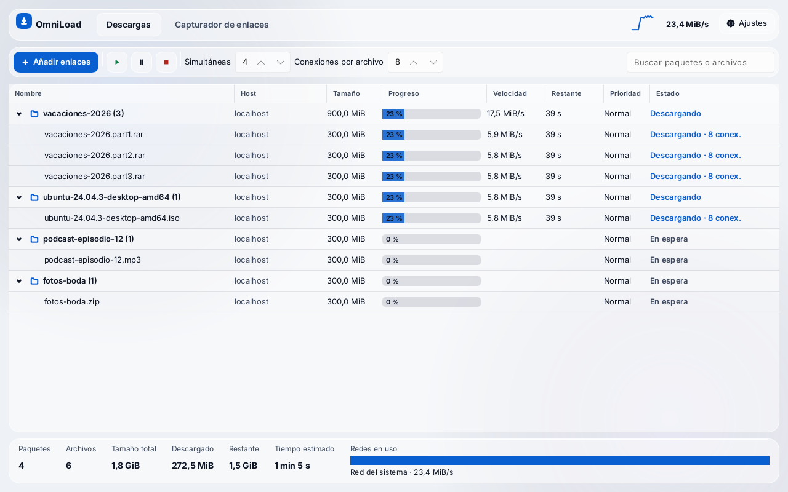
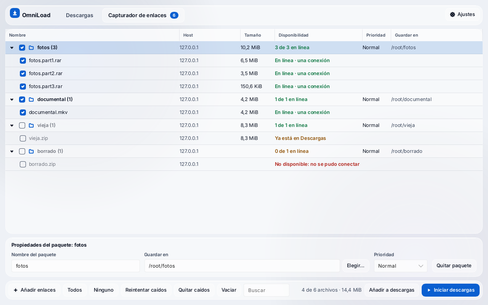
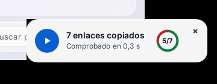
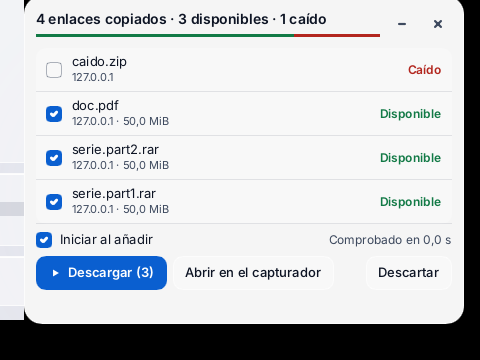
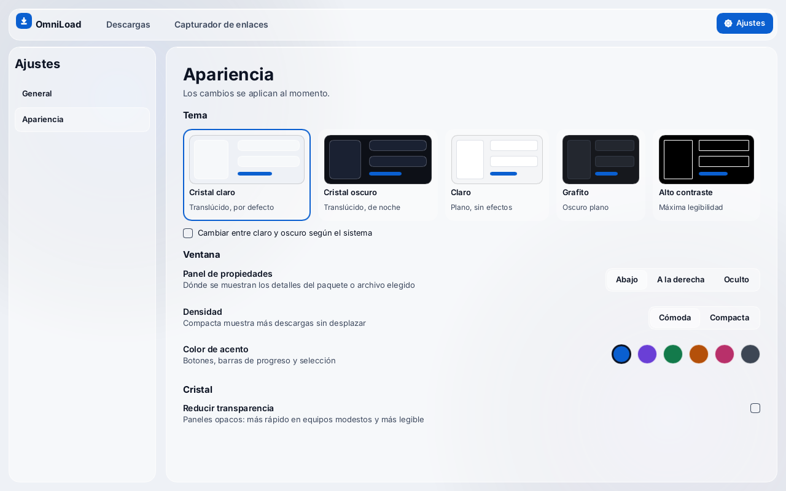

<div align="center">

# OmniLoad

**Descarga más rápido, con todo ordenado y sin anuncios.**

Un gestor de descargas libre y gratuito para Windows, macOS y Linux.
Copias un enlace y OmniLoad se encarga del resto.


[](https://github.com/Danijimzzz/OmniLoad/actions)



</div>

## ¿Por qué OmniLoad?

- ⚡ **Más rápido.** Cada archivo se baja por varios trozos a la vez, así
  aprovechas toda tu conexión aunque el servidor vaya lento.
- ⏯️ **Nunca empiezas de cero.** Pausa cuando quieras; si se corta internet,
  se apaga el ordenador o se va la luz, sigue justo donde lo dejó. Tu lista de
  descargas también se guarda: al volver a abrir, todo está como lo dejaste.
- 🚦 **No te deja sin internet.** Pon un límite de velocidad y sigue viendo
  vídeos o jugando mientras descarga.
- 🌙 **Sigue aunque cierres la ventana.** Al cerrarla, OmniLoad se queda en
  un iconito junto al reloj y sigue descargando sin estorbar. Un clic en el
  icono y vuelve la ventana.
- 🔔 **Te avisa al terminar.** Una notificación cuando acaba un archivo o un
  paquete entero, para que no tengas que estar mirando.
- 📋 **Copia y listo.** Copia un enlace en cualquier sitio y OmniLoad lo detecta
  solo. No hace falta pegar nada. Hasta pilla los enlaces escondidos detrás
  de un "descarga aquí" cuando copias un trozo de una web.
- 🔎 **Mira antes de bajar.** Antes de descargar te enseña qué hay detrás de
  cada enlace: nombre, tamaño y si sigue disponible. Cien enlaces se
  comprueban en un par de segundos.
- 🔁 **Sin repetir.** Si un enlace ya está en tus descargas, te avisa y no lo
  marca, para que no bajes lo mismo dos veces.
- 🗂️ **Todo en su sitio.** Cada grupo de archivos va a su propia carpeta, con
  su nombre.
- 🎨 **A tu gusto.** Cinco temas, modo oscuro y colores para elegir.
- 🪶 **Ligero y libre.** Programa nativo, sin navegador escondido dentro, sin
  anuncios y con el código abierto.

## Cómo se usa

1. **Copia los enlaces** que quieras bajar (de una web, un correo, un chat…).
   También puedes pulsar **Añadir enlaces** y pegarlos, o abrir una lista de
   enlaces guardada en un archivo `.txt` o una página `.html`.
2. **Elige qué bajar.** OmniLoad comprueba cada enlace y agrupa los archivos
   que van juntos (por ejemplo, las partes de un mismo `.rar`). Si pegas una
   página web, encuentra los archivos que enlaza.
3. **Pulsa Iniciar descargas** y olvídate. Puedes cerrar la ventana cuando
   quieras: la próxima vez continúa donde se quedó.

## Lo que puedes hacer

### Capturador de enlaces



Todo lo que copias o pegas llega aquí antes de descargarse. Verás cada archivo
con su tamaño y si está **en línea** o **caído**, agrupado en paquetes. Marca lo
que quieras, cambia el nombre o la carpeta del paquete y elige su prioridad.

- Lo que **ya tienes en Descargas** aparece desmarcado y avisado.
- Si un enlace falló porque se cortó internet, **Reintentar caídos** los
  vuelve a mirar.
- La lista **no se pierde**: aunque cierres la ventana o apagues el ordenador,
  al volver sigue ahí.

### Aviso al copiar enlaces

<p>

&nbsp;

</p>

Al copiar enlaces aparece un pequeño aviso abajo a la derecha, sin taparte lo
que estés haciendo. La rueda se llena de **verde** con los enlaces buenos y de
**rojo** con los caídos, y con el botón ▶ empiezas a descargar al momento.
Puedes elegir el aviso **compacto**, el **completo** con la lista de enlaces, o
quitarlo. Al terminar de comprobar se desvanece poco a poco (y si pasas el
ratón por encima, se queda).

### Descargas

- Varias descargas a la vez, y tú decides cuántas.
- Prioridad alta, normal o baja para cada paquete.
- Velocidad, tiempo restante y progreso de cada archivo y de cada paquete.
- Iniciar, pausar o detener todo con un clic, y buscar entre tus descargas.
- **Límite de velocidad** en la barra de arriba (por ejemplo, 2 MB/s), que se
  aplica al momento, también a lo que ya se está bajando.
- Al salir de OmniLoad, lo que se estaba bajando queda en la cola y **sigue
  solo** la próxima vez que lo abras. Y si activas **Seguir descargando al
  salir** (en Ajustes), ni siquiera se para.
- Si un servidor limita las conexiones, OmniLoad se adapta solo y **lo
  recuerda** para la próxima vez. En Ajustes puedes poner cuántas conexiones
  abrir como mucho a una misma web, y las descargas a la misma web se reparten
  las conexiones de forma justa.
- Si un enlace caduca, te lo dice claramente.
- **Quitar con calma.** Al quitar una descarga eliges: «Quitar de la lista»
  (lo normal: los archivos se quedan en tu carpeta) o «Quitar y borrar
  archivos» (también borra lo descargado y la carpeta del paquete si queda
  vacía; nunca toca tu carpeta de descargas ni otras carpetas con tus cosas).
- **Tu carpeta, limpia.** Mientras descarga solo ves el archivo a medias
  (`.part`); lo que OmniLoad necesita para reanudar lo guarda aparte.
- **Números que se leen bien.** La velocidad y el tiempo restante se
  actualizan una vez por segundo y no dan saltos.

### Junto al reloj (bandeja del sistema)

Cerrar o minimizar la ventana no para nada: OmniLoad se queda en la bandeja
del sistema, junto al reloj, y sigue descargando y vigilando lo que copias.

- **Un clic en el icono** y vuelve la ventana. Al pasar el ratón ves cuántas
  descargas van y a qué velocidad.
- Con el **botón derecho**: pausar o reanudar todo, activar o quitar la
  vigilancia del portapapeles y **Salir** del todo.
- Si abres OmniLoad otra vez, no se abre una segunda ventana: aparece la que ya
  tenías.
- ¿Prefieres que la X cierre el programa? Desactívalo en **Ajustes ›
  General**.

### Versión

En **Ajustes › Versión** ves qué versión tienes. Al abrir, OmniLoad mira en
GitHub si hay una nueva y, si la hay, te lo dice con un botón en la barra de
arriba. Nunca descarga ni instala nada por su cuenta: tú decides. Si no quieres
que mire, se desactiva ahí mismo.

### Que se haga solo

En **Ajustes › Automático**:

- **Horario de descargas.** Elige los días y las horas en que se puede
  descargar (por ejemplo, de 23:00 a 07:00). Fuera de ese horario todo queda en
  pausa, con el progreso guardado, y sigue solo cuando llega la hora.
- **Carpeta según el tipo de archivo.** Vídeos a una carpeta, `.zip` a otra,
  lo que quieras: escribes las extensiones y eliges la carpeta.
- **Al terminar todas las descargas**: no hacer nada, cerrar OmniLoad,
  suspender o apagar el equipo (con 60 segundos para cancelar).
- **Iniciar con el sistema**, escondido en la bandeja.

### Hecho a tu gusto

- **Listas desplegables con teclado**: con el foco puesto, ↑ ↓ cambian la opción e Intro o espacio abren la lista.
- **Números con − y +**: haz clic, mantén pulsado para que repita, o escribe el número directamente.
- **Columnas de la lista**: arrastra el borde de la cabecera para cambiar el
  ancho, arrastra el nombre de una columna (Nombre incluido) para cambiarla de
  sitio. Con **clic derecho en una cabecera** puedes ocultar esa columna, ver la
  lista de columnas con sus tics para mostrar u ocultar cualquiera, o
  restablecerlas. La columna Nombre se estira sola para llenar la
  tabla. Vale para las descargas y para el Capturador de enlaces. Se recuerda.
- **Tamaño de letra** (pequeña, normal o grande), **escala de la interfaz** y
  **desenfoque del cristal** en Ajustes › Apariencia.
- **Límite de velocidad**: elige uno de la lista o escribe el tuyo («700 KB/s»,
  «3 MB/s»).
- Paneles que se pueden ensanchar arrastrando su borde, y ventana con borde
  fino, barra de título propia y tamaño libre.
- **Win+D** y la barra de tareas funcionan como en cualquier programa: la
  ventana se minimiza y vuelve. Solo el botón de minimizar de OmniLoad la
  esconde en la bandeja.
- Fluida incluso con **10.000 descargas** en la lista.

### Apariencia



Elige entre **Cristal claro**, **Cristal oscuro**, **Claro**, **Grafito** y
**Alto contraste**, o deja que cambie solo entre claro y oscuro con tu sistema.
También puedes elegir el color de acento, una vista más compacta para ver más
descargas y dónde se muestran los detalles.

## Descargar

Aún no hay instaladores publicados: llegarán a la página de
[Releases](https://github.com/Danijimzzz/OmniLoad/releases) para Windows, macOS
y Linux.

Mientras tanto puedes compilarlo tú mismo en dos pasos:

1. Instala [Rust](https://rustup.rs).
2. Descarga este proyecto y, dentro de su carpeta, ejecuta:

   ```sh
   cargo build --release -p omni-gui -p omnid -p omni-cli
   ```

   y abre `target/release/omniload` (`omniload.exe` en Windows). Los tres
   programas tienen que estar en la misma carpeta, como quedan al compilar.

   (`cargo run --release -p omni-gui` también vale, pero sin `omnid` las
   descargas se paran al cerrar la ventana.)

En Linux necesitas además `libfontconfig-dev` y `libxkbcommon-dev`
(`sudo apt install libfontconfig-dev libxkbcommon-dev` en Debian/Ubuntu). En
GNOME, el icono de la bandeja necesita la extensión «AppIndicator» (Ubuntu ya
la trae); el resto de escritorios lo muestran sin más.

## Próximamente

- Descargar de Mega, Gofile, Google Drive y Mediafire.
- Descomprimir automáticamente, con contraseñas.
- Descargar usando varias conexiones a internet a la vez (por ejemplo, wifi y
  cable juntos).

## Para desarrolladores

¿Quieres usar OmniLoad desde la terminal (`omni add`, `omni list`, `omni
check`, `omni limit 2M`…), compilarlo o saber cómo funciona por dentro? Está todo en [docs/DESARROLLO.md](docs/DESARROLLO.md).

## Licencia

OmniLoad es software libre bajo la licencia
[GPL-3.0-or-later](LICENSE): puedes usarlo, estudiarlo, compartirlo y
mejorarlo.
